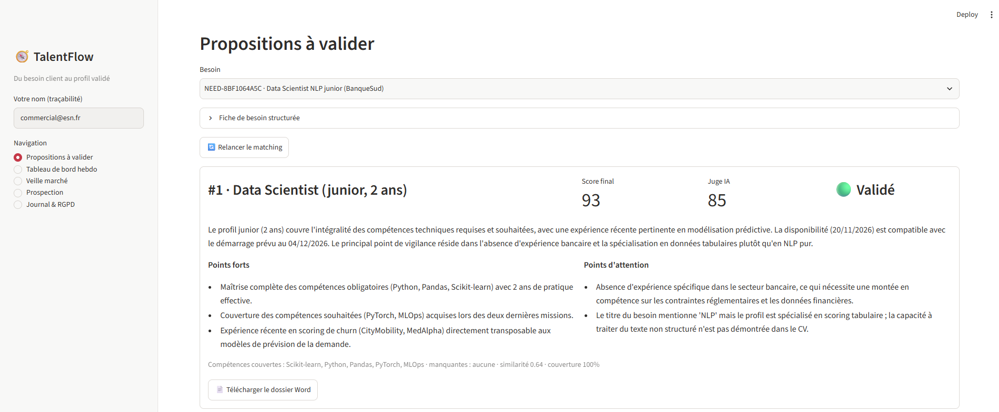
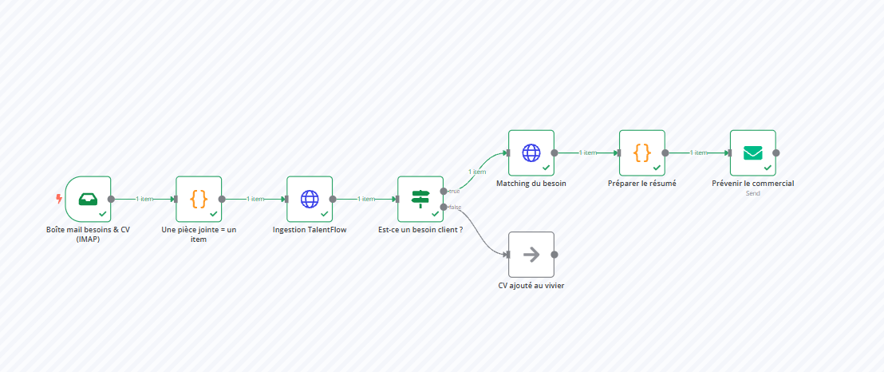
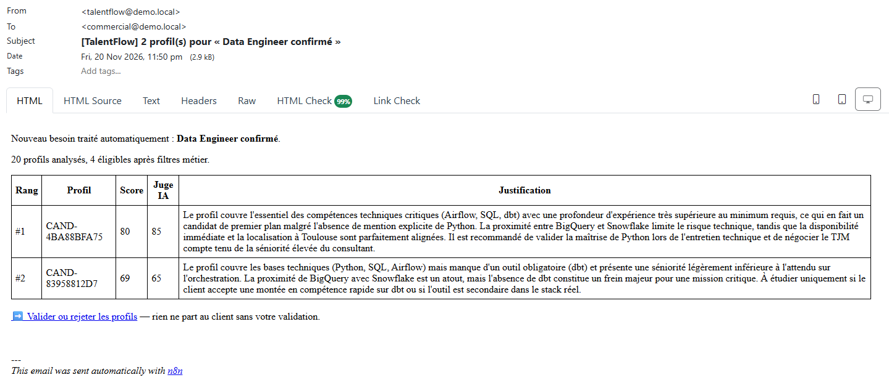
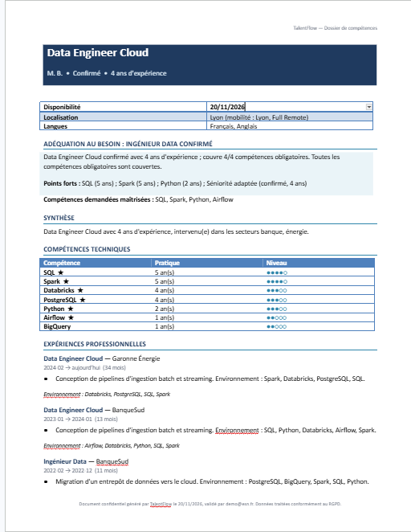
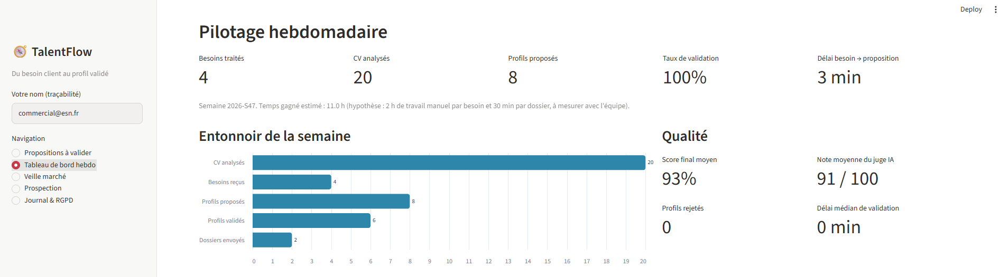
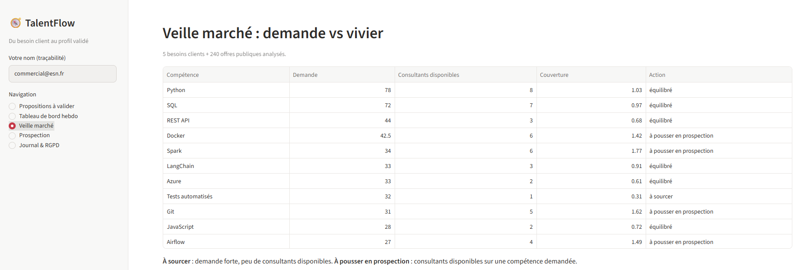

# TalentFlow — AI staffing pipeline for IT consulting firms
 
From a client request received by email to a validated skills file, in minutes, with a human in the loop.
 
TalentFlow reads incoming job requests and CVs, pseudonymizes personal data (GDPR), extracts structured profiles with an LLM, ranks the best consultants, explains each match, and generates the Word skills file once a sales rep approves.
 

 
## How it works
 
```
Client email ─► n8n ─► FastAPI
                         │  parse (PDF/DOCX/TXT) → pseudonymize → LLM extraction (Pydantic-validated)
                         │  matching: PGVector top-k → business filters → LLM-as-a-judge
                         ▼
              sales alert ─► human validation (Streamlit) ─► Word skills file ─► n8n sends it + Boond positioning
                         ▼
              PostgreSQL ─► weekly dashboard · market watch · prospecting drafts
```
 
**Matching funnel**
1. **Retrieval** — 30 closest profiles by embedding similarity (PGVector, HNSW).
2. **Business filters** — availability, location, daily rate, seniority, languages. Excluded profiles keep their reason.
3. **LLM-as-a-judge** — score /100 + written justification. Final score = 60% explainable pre-score + 40% judge.
## Screenshots
 
**n8n — email received → ingestion → matching → sales alert**

 
| Sales alert (LLM justifications) | Generated skills file |
|---|---|
|  |  |
 
**Weekly dashboard**

 
**Market watch — demand vs. available consultants**

 
## Features
 
- **Ingestion** — email (n8n / IMAP / Microsoft Graph), REST API, drop folder (Airflow), BoondManager sync; SHA-256 deduplication
- **GDPR by design** — direct identifiers replaced by tokens before any LLM call, sensitive data removed, separate PII vault, retention purge, right to erasure, audit log
- **LLM extraction** — JSON validated by Pydantic, self-correction loop, rule-based fallback, on-disk cache
- **Explainable matching** — business filters + LLM judge with strengths, gaps and justification
- **Human in the loop** — nothing is sent without approval; rejections require a reason
- **Skills file generation** — Word document tailored to the request, initials only
- **Market watch & prospecting** — skills to source vs. skills to push, personalized email drafts
- **Weekly reporting** — dbt models, Streamlit dashboard, Monday email via n8n
- **Evaluation** — annotated synthetic set, ablation study, quality gates in CI
## Tech stack
 
Python · FastAPI · Pydantic · PostgreSQL + PGVector · n8n · Airflow · dbt · Streamlit · python-docx · Docker Compose · GitHub Actions
LLM providers: Groq, OpenAI, Mistral, Gemini, Ollama, llama.cpp (local, no data leaves the machine)
 
## Quick start
 
**Local, no API key**
```bash
pip install -e ".[all]"
talentflow demo --consultants 20 --needs 4   # synthetic CVs → matching → Word files
talentflow eval                              # report in reports/evaluation.md
pytest -q
```
 
**Full stack (Docker)**
```bash
cp .env.example .env
docker compose up -d --build
docker compose exec api python -m talentflow.cli demo --consultants 20 --needs 4
docker compose exec n8n n8n import:workflow --separate --input=/workflows
```
 
| Service | URL |
|---|---|
| API docs | http://localhost:8000/docs |
| Sales UI | http://localhost:8501 |
| n8n | http://localhost:5678 |
| Mailpit (demo inbox) | http://localhost:8025 |
 
Set `TF_LLM_PROVIDER` and `TF_LLM_API_KEY` in `.env` to use a real LLM (`offline` by default). n8n setup: [docs/n8n.md](docs/n8n.md).
 
## Evaluation
 
On the synthetic annotated set (20 CVs, 4 requests), LLM extraction:
 
| Metric | Result |
|---|---|
| PII leaks to storage / LLM | 0 / 90 checked values |
| CV skills F1 | 0.99 |
| Request required-skills F1 | 1.00 |
| Matching MRR — similarity only → + business filters | 0.75 → 1.00 |
| Matching nDCG@5 — similarity only → + business filters | 0.82 → 0.90 |
 
Synthetic data only: these numbers track regressions and compare variants, not real-world performance.
 
## Project structure
 
```
src/talentflow/   ingestion · privacy · llm · extraction · embeddings · matching
                  storage · generation · connectors · workflow · evaluation · api
dashboard/        Streamlit sales UI
n8n/workflows/    4 importable workflows
airflow/dags/     daily catch-up, weekly maintenance
dbt/              staging and mart models + tests
docs/             architecture, GDPR, n8n setup, demo script, screenshots
```
 
## License
 
MIT — Salma Ben Chaouacha
 