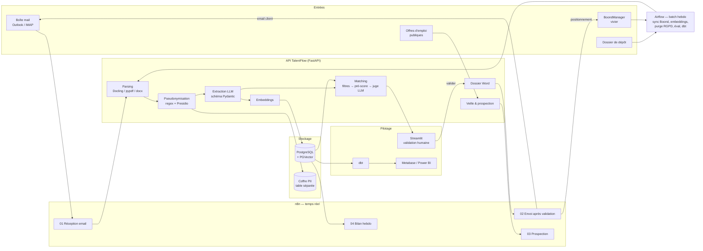
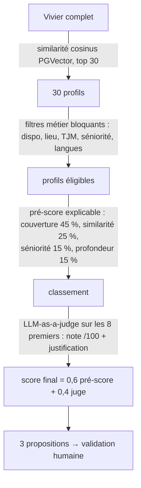

# Architecture

## Vue d'ensemble

## Pourquoi ce découpage n8n / Python / Airflow

| Besoin | Outil | Raison |
|---|---|---|
| Réagir à un email en quelques minutes, brancher Outlook, Boond, le CRM | **n8n** | Connecteurs prêts à l'emploi, modifiable par l'équipe sans redéploiement |
| Extraction, pseudonymisation, matching, génération | **Python (API)** | Logique testable (Pytest), versionnée, évaluée à chaque modification |
| Traitements lourds et planifiés, avec reprise et historique | **Airflow** | Ré-indexation, purge RGPD, évaluation de non-régression, dbt |
| Indicateurs du tableau de bord | **dbt + Metabase** et Streamlit | Modèles SQL testés ; Streamlit pour le quotidien des commerciaux |

## Le matching en entonnoir

- **Pourquoi des filtres avant le LLM** : un profil indisponible ou hors budget ne doit pas être
  proposé, quelle que soit sa note. Les filtres sont déterministes, explicables et gratuits.
- **Pourquoi un juge LLM** : il lit les expériences comme un commercial (contexte, récence),
  ce qu'une simple similarité ne fait pas, et produit une justification lisible.
- **Pourquoi le juge ne décide pas seul** : son score est combiné au pré-score, et un humain valide.

## Modèle de données

| Table | Contenu | Données personnelles |
|---|---|---|
| `documents` | texte **pseudonymisé**, nom de fichier masqué, empreinte SHA-256 (dédoublonnage) | non |
| `pii_vault` | correspondance jeton → valeur réelle | **oui**, isolée, effacée à la demande |
| `candidates` | profil structuré (JSON validé), date limite de conservation | non |
| `candidate_embeddings` | vecteur `vector(n)` + index HNSW | non |
| `needs` | fiche de besoin structurée | non (contact client masqué) |
| `matches` | scores, justification, statut, relecteur, motif de rejet | non |
| `prospection_emails` | brouillons, statut (draft → approved → sent) | non |
| `audit_log` | qui a fait quoi, quand | identifiant du relecteur |

## Fournisseurs interchangeables

Tout passe par des interfaces ; on change de fournisseur par variable d'environnement.

| Composant | Hors-ligne (démo, CI) | Cloud | Local (souverain) |
|---|---|---|---|
| LLM | règles + juge heuristique | OpenAI, Mistral, Groq, Gemini | llama.cpp, Ollama |
| Embeddings | hashing (scikit-learn) | OpenAI, Mistral | sentence-transformers, Ollama |
| Base | SQLite | PostgreSQL managé | PostgreSQL + PGVector |
